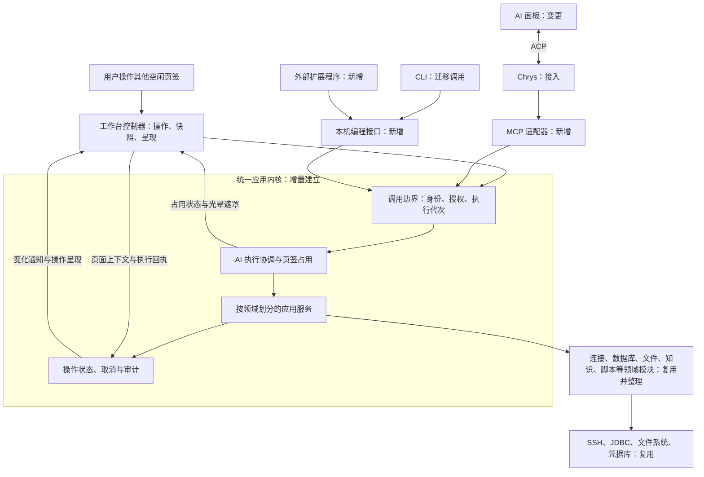

# OpsCopilot 统一应用架构设计

状态：2026-10-21 实施基线；首批终端接手、真实 Chrys 持续对话、数据库交接、Skills 与快捷命令已完成本地链路验证。当前阶段状态与证据见第 10 节。完整能力迁移、目标内网兼容和发行包验收仍未完成。

## 1. 架构决策

采用模块化单体，以页签作为人与 AI 的操作隔离边界。每个软件进程只有一个 AI 执行序列，可操作多个页签；界面、AI、CLI 和外部扩展通过各自适配器使用统一应用服务。

统一应用内核负责操作入口、页签占用、执行控制与审计，各领域继续管理自身业务与资源。前端保留页面和编辑状态，通过工作台控制器提供稳定的操作、快照及回执；不以全量状态迁入 Go 或新建通用文档数据库为前置条件。

桌面默认在本机拥有一份常驻运行实例；JDBC、Chrys、扩展程序可以作为受管理的独立进程存在。用户不必为这些能力部署远程服务。未来更换宿主时替换装配和通信适配器，核心模块保持稳定。

设计目标是用户看到 AI 原生操作软件，并能立即中断、接手。已有状态在交接时延续，停止后的旧调用不能继续操作；开发者可以用轻量扩展实现一键连接等动作。

## 2. 总体结构与依赖方向



静态依赖从适配器指向应用接口，再指向领域模块和基础设施端口。核心模块不导入 Wails、React、ACP 或 MCP 类型。跨模块使用公开接口，不读取对方私有存储，也不持有对方内部状态容器。

事件用于发布已经发生的变化、更新视图；必须得到结果的业务步骤使用显式调用。连接、查询等关键流程不依靠一串无法追踪的事件订阅拼接。

| 边界 | 负责 | 不承担 |
|---|---|---|
| 宿主与协议适配器 | Wails、ACP、MCP、本机 RPC 的通信、参数转换与生命周期接入 | 业务规则、直接访问领域存储 |
| 应用服务 | 完成用户意图、协调模块、确定状态与结果归属 | SSH/JDBC 协议实现、页面布局 |
| 执行协调 | 单 AI 执行序列、消息排队/立即发送、占用与释放、取消 | 自建 Agent 推理循环或多任务并行调度平台 |
| 运行管理 | 操作状态、句柄索引、取消、审计和状态查询 | 接管所有领域内部状态或计算资源拓扑 |
| 工作台控制器 | 页签操作、页面快照、编辑状态、结果呈现、占用遮罩 | 接受绕过授权或已经失效的 AI 调用 |
| 领域模块 | 连接、查询、文件、知识等业务规则及自身数据 | 识别调用者使用了哪个前端或 AI |
| 扩展程序 | 自己的计算、发现和编排 | 直接改写应用内部文件或绕过公开接口 |

## 3. 一套能力，多种入口

应用服务按领域提供强类型接口，例如 ConnectionService、DatabaseService、FileService。公共调用边界统一校验身份与权限、输入输出契约、超时和调用记录，再转交对应服务。

能力目录只登记可开放的应用操作及版本、参数、返回值和权限要求，用于适配 MCP 和编程调用。进程内保留强类型接口，业务实现只有一份；首版围绕接手终端、查看日志、连接数据库等完整用例增加操作，不先建设覆盖全部功能的通用框架。

操作分为三类：

- 查询：获取资源、运行、文档和结果的快照，不改变现场。
- 命令：创建连接、打开查询文档、执行 SQL 等，返回明确结果或任务 ID。
- 会话与流：终端、持续输出和大文件传输，使用句柄及专用流通道。

终端字节流沿用专用通道。用户普通输入保持交互体验，AI 的完整命令和扩展的受控调用先经过授权与审计，再进入目标终端。不能给 AI 一个通用原始按键/字节接口去绕过命令控制，也不能把“输入已发送”当成“远端执行成功”。

新增一个功能时，业务实现、授权和状态更新只有一份；不同入口只增加必要的参数转换和呈现。低频、危险或不适合 AI 的操作可以不暴露为工具，不把全部内部方法机械映射给 AI。

## 4. 页签占用与操作交接

### 4.1 已确定的产品行为

- 同一进程只有一个 AI 执行序列，其他消息排队，不提供多个独立 AI 任务并行运行。
- AI 对话不依赖 SSH、数据库等资源连接。各工具在使用时检查自己的资源与授权；缺少某类资源只限制相应工具，不作为启动聊天的前置条件。
- 默认在用户发起本轮任务时的当前页签操作。用户后续切换页签浏览，不改变该轮已经绑定的操作目标。
- AI 可按任务需要新建页签；用户明确要求独立页签时必须新建。AI 一轮可占用多个页签。
- 对话运作与页签占用分开。闲聊、思考和屏幕读取不触发占用，也不自动结束已经存在的占用；模型在操作需要避免人工干扰时显式申请占用，完成后主动释放，不必等到整轮对话结束。
- AI 占用的页签内容可见，彩色光晕遮罩阻止人在页签内操作，标题显示 AI 占用标识。用户可操作其他页签，也可从工作台入口新建、复制页签。
- 正常结束、异常结束、手动接管、点击停止均结束当前运作并释放占用。
- 队列消息点击“立即发送”时打断旧运作，释放占用，再按新消息启动；普通排队不打断。
- 提问与命令审批不自动改变占用状态。模型决定当前操作段是否仍需保护现场；无需保护时明确释放。批准命令只授予原命令的执行权，不能自动改变窗口占用；人工接管和停止始终优先。

### 4.2 执行约束

页签占用由应用层和工作台控制器共同执行，遮罩负责呈现。AI 调用携带绑定于当前运作及本次占用的执行代次，不能由模型自行声明所有权。停止或释放时使旧代次失效，在实际写入/修改前再次核验。停止前已经发出的结果可追加到对应历史记录，但不得抢回焦点、覆盖新状态或触发后续操作。

模型通过接手/释放工具表达占用意图，宿主负责授予、核验和兜底回收。终端发送命令必须已经持有有效占用权，不因收到命令而隐式加锁。只读屏幕观察使用独立的读取授权与审计接口，不初始化 Shell 或获得输入能力。界面遮罩及占用徽标依据后端的实际占用状态，不能从“模型正在运行”推导。

这里的运作状态属于本机执行协调，不等同于启动或终止 Chrys 进程。是否等待回答与是否占用是两个状态；保持占用的待批命令必须仍受停止、过期、身份与现场核验约束。“立即发送”通过取消当前轮次、处理待答回调并启动下一轮实现。切换期间旧调用失效，任一时刻只有一轮具备执行权限。

AI 停止时立即撤销后续输入权、解除遮罩。已经发送给远端的命令另行尝试停止；终端如仍有前台进程运行，必须如实显示，让用户能够接手处理。释放页签不等于远端进程已经终止。

同一页签采用单一操作方，首版不设计人和 AI 在同一文档内同时编辑的合并机制。回答问题后或重新接管时依然读取版本与最新内容，避免旧状态覆盖用户的中间操作。

复制页签须有独立输入与执行状态。可以复制连接配置、SQL 等可重建内容；活动 Shell 进程、su 身份和数据库事务不能宣称可原样克隆。不同页签若共享底层资源，断连、删除等跨页签操作仍需核验占用，不能破坏另一个正在使用的现场。

### 4.3 状态边界

| 状态 | 唯一负责者 | 保存与恢复边界 |
|---|---|---|
| 保存的服务器、数据库配置、扩展定义 | 对应领域存储 | 持久化，使用稳定 ID 和版本 |
| SSH、数据库连接、终端进程 | 对应领域服务，运行管理维护索引 | 进程内活跃句柄；应用重启不声称仍然连接 |
| 页签、SQL 内容、文件位置、结果关联 | 工作台控制器及对应页面状态 | 提供可寻址操作与版本化快照；持久化按实际需要增量补齐 |
| AI 当前运作与占用 | 执行协调模块 | 进程内唯一执行序列；停止后旧调用失效 |
| 执行任务与结果 | 对应服务，运行管理统一索引 | 记录状态、错误与结果引用；重启时核实或标记中断/结果未知 |
| 布局、滚动、输入法组合、尚未提交的输入 | 前端 | 属于视图状态，不承担后端事实的权威来源 |
| 密码、令牌 | 凭据存储 | 普通快照和 AI 上下文使用引用，不返回明文 |

连接、页签、AI 运作和具体操作分别有 ID，不混用 sessionId。数据库事务和执行中的语句由明确的数据库会话管理；多个独立页签需要独立执行上下文时建立独立会话。

页面卸载、关闭页签、关闭连接和停止 AI 分别定义生命周期。浏览器重载时撤销尚未确认的界面写入权限，重连后读取实际快照再继续，不能只靠一次性通知恢复，也不能把组件卸载直接等同于所有后台操作结束。

## 5. AI 操作与用户体验

### 5.1 原生操作与页面上下文

工作台提供打开终端、创建连接、打开文件、读取日志、执行查询等语义操作。AI 调用原生接口，界面展示真实操作过程；首版不采用截图识别、鼠标模拟或控件坐标操作。

页面快照包含页签 ID、类型、资源、可见内容、选区、文件位置和内容版本等必要上下文。用户说“这个日志”“看前面”，结合发送消息时的页面上下文解释；已绑定的任务页签与用户当前浏览页签分别记录。页面内容属于待分析数据，不构成新增授权。

业务成功与呈现完成分别报告。后台查询可以在没有界面时完成；“打开并显示结果”还需要指定宿主/窗口处理呈现请求并回执。没有可用界面时明确返回呈现不可用，不声称用户已经看到结果。

呈现请求包含目标页签、来源调用和是否需要切换焦点。AI 使用多个页签时标题持续标识占用，用户在其他页签浏览不被后台进度反复抢回焦点。多层页签与共享资源如何映射到独立操作单元，在原型中验证。

### 5.2 普通命令行接手

AI 接管当前终端的同一个 Shell，会延续用户已经形成的账号、目录和环境。独立 SSH exec 连接可以作为另一个明确操作存在，不能用它冒充对当前终端的接手。

首版优先支持普通命令行。遇到 less、zsql、vim 等交互式程序，或不能确认当前状态时停止自动输入并与用户沟通。不能仅凭提示符形状宣称 Shell 已就绪，也不能仅凭用户输入记录推断实际执行身份。

终端适配器必须给出命令提交、输出边界、完成/退出状态和中断状态。现有 CommandExtractor 用于命令提取和补全修正，不构成完整的 Shell 执行契约。[接手原型](terminal-handoff-feasibility.md) 已在本地 ash/Bash 中验证临时提示符标记和同 Shell 延续；首次/环境重置后的确认、严格输出归属、复杂提示符和内网适配仍需正式实现与验证。

### 5.3 Chrys 接入与提问

AI 面板通过 ACP 管理 Chrys 会话、消息流、工具进度和权限交互；Chrys 通过本机 MCP 调用 OpsCopilot 的公开能力。Chrys 负责推理、Skill 加载和任务探索，OpsCopilot 负责真实执行与现场控制，不另建一套 Agent 推理或流程调度引擎。

允许 AI 自主探索业务、服务和日志位置，也必须能够主动提问。接入 Chrys 的 chrys/request_input 扩展，在助手里显示单选、多选和自由文本问题卡片。答案直接回应对应提问，不进入普通消息队列；停止运作时撤销待答请求，迟到答案不恢复旧运作。模型明确控制等待期间是否保留占用；继续操作时核对最新现场。

接入后需要扩展目前只有 ask/subscribeStatus 的 AssistantRuntime，使其支持会话、流式消息、工具操作、交互请求和取消。AI 不可用时，手动工作台照常使用。

## 6. 轻量自定义动作

首版由开发者编写动作脚本与少量声明，用户填写参数后点击执行，或用一句话让 AI 调用已有动作。支持 Python、Java、Shell 等外部程序，动作自己承担业务发现、计算和编排。运行环境需求由动作声明，不承诺首版自动安装各种语言运行时。

声明包含动作标识、说明、版本、输入参数、执行入口及所需权限。宿主负责参数呈现、启动/连接、进度、超时、取消和错误。首版不建设普通用户可视化编排器或 AI 自动生成插件功能。

动作可通过公开接口直接连接服务器、连接数据库并打开页签，完成一键操作。接口承担凭据处理、连接生命周期、页签登记及失败呈现。返回资源/页签 ID 和分项结果，供 AI 接续使用；无需把一切动作先转换成通用资源导入流程。

例如输入管理面地址与凭据，动作计算得到业务节点和数据库端点后，直接调用“连接并打开”操作。用户点击时由用户使用创建的页签；AI 调用时继承本轮授权和占用规则。动作不需要依赖 AI 才能运行。

节点的业务归属、来源和跳转关系需要可追溯。连接身份包含实际访问上下文，不能把不同 SSH 节点后的 127.0.0.1 合并。重复运行复用稳定映射，不静默覆盖用户改过的名称与分组；部分失败返回分项结果，避免整批盲目重试。

凭据若由脚本产生，通过受控输入通道写入凭据服务后返回引用。业务结果、进度和错误分通道处理，不能把带凭据的完整原始输出直接展示给 AI。

首期将本机可执行扩展视为用户信任的代码。独立进程可以隔离崩溃，但不等于操作系统安全沙箱；API 授权不能阻止同用户权限的恶意进程直接访问本机文件。支持不可信插件需要另外设计实际隔离环境。

## 7. 授权、审查与审计

### 7.1 已确定的默认边界

- 授权范围内的常规只读排查自动继续。
- 修改配置、重启服务、删除数据、读取敏感凭据等操作，必须由用户明确确认。
- 使用保存的凭据建立获准连接可正常执行；将凭据内容读取出来交给模型属于敏感操作。
- 用户指定业务后，动作发现的所属节点纳入本轮只读排查；跨业务、跨环境或归属不明确时询问用户。
- 两类操作均审计。复杂命令、不透明脚本或无法可靠判断的行为，不凭名称或模型自述认定只读。

### 7.2 复用 Chrys，保留执行侧控制

复用 Chrys 工具审批流程、人工/自动审查能力、ACP session/request_permission 交互和审批记录的关联方式。Chrys 内置 Shell 的只读与敏感目标判断不会自动套用到远程 MCP 工具；其本地工作区自动放行规则不能直接移植为服务器权限。

调用者身份由入口绑定，AI 或动作不能自行声明更高权限。OpsCopilot 在实际执行前核验页签占用、运作代次、目标/账号、命令与授权范围。Chrys 自动审查或跳过模式不能绕过宿主要求明确确认的规则。

同一次操作目标是只确认一次。审批与实际命令绑定同一操作记录，目标、账号、命令或关键上下文改变时重新校验，旧批准不可复用。ACP 审批回调与本机 MCP 执行的可靠关联，以及无法关联时的拒绝/补充确认策略，列为联调验收项，不能默认普通工具成功事件等于可信批准凭证。

### 7.3 实际执行审计

Chrys 记录 AI 侧工具调用，OpsCopilot 记录实际执行事实：来源、运作/页签/操作 ID、节点、账号、脱敏命令、授权依据、提交与完成时间、结果/错误及取消状态。关联两端记录，但不以对话记录代替服务器操作审计。

既有 CLI 命令入口有白名单检查，桌面终端输入和脚本回放另有直接写入路径。AI 与动作经软件执行命令时必须进入受控入口；原始写入不能成为旁路。外部动作是可信代码，若它自行使用 SSH 等库绕过软件 API，其行为不在本机接口审计覆盖内；声明和执行记录需如实标注范围。

## 8. 失败语义与恢复边界

每次调用可追踪来源、目标、状态和脱敏错误。超时、取消和重试有明确语义：

- 本地停止等待、远端确认停止、执行结果未知分别表达。
- 写入或远程副作用只在已知可幂等、可安全重试时自动重试。
- 应用重启不自动重放 SQL、Shell 命令等副作用操作。
- 扩展或 Chrys 崩溃只清理它拥有的任务/租用句柄；用户接手后的资源按新的所有权继续管理。

不默认永久保存全部终端输出、SQL 结果或凭据。运行记录保存必要事实，结果按大小和保留策略独立管理。

## 9. 代码组织与迁移

建议新增边界，名称可在接口评审时调整：

```text
internal/workbench/
  contract/        公共 DTO、错误、ID 与能力版本
  application/     按领域划分的应用服务和必要的跨模块用例
  execution/       单 AI 执行序列、队列、中断、页签占用与代次
  operations/      操作记录、实际审计、授权及取消
  extensions/      动作声明、输入、执行及编程接口适配
  adapters/        Wails、本机 RPC、MCP、ACP 接入

pkg/remote、pkg/dbworkspace、pkg/knowledge 等
                    保留并整理现有领域与基础实现

frontend-shell/src/workbench/
                    页签控制器、上下文快照、原生操作和呈现回执
```

App 逐步成为宿主装配和兼容门面。现有 core/ops 与 sidecar 通过适配器复用或迁入统一服务，不能长期与应用内核各维护一套同范围的会话和业务规则。

CLI 对当前桌面现场的操作连接常驻实例；无界面使用时，可以由相同装配启动独立运行实例，明确两者的现场不同，不冒充共享用户页签。

保留现有配置、知识和脚本存储，通过存储接口接入；不以一次全量数据库迁移为前置条件。新增必要操作与审计记录，单独定义版本及恢复策略。

仓库已有的 architecture-evolution-plan.md 是更广泛的工作台演进草案。本文收敛当前应用内核、ACP 和扩展的实施边界；WorkItem、Workflow、代码工作副本等后续能力不成为本轮前置条件，也不沿用未经验证的整体排期。

## 10. 整体实施路线与阶段交付

本轮终点是：用户在现有助手中提出业务排障要求，AI 可以接手当前普通终端、使用多个页签、提问与接受中断；用户和 AI 均可调用开发者提供的一键动作，连接业务节点及数据库；已开放能力具备统一授权、实际审计和稳定的扩展接口。

按以下路线逐步交付。阶段号表示依赖与验收顺序，不要求所有模块同步重构。阶段 1 的本地技术探索已完成，见[验证报告](terminal-handoff-feasibility.md)；阶段 2、3 已接通真实 Chrys、受控终端和持续对话，见[助手试用说明](assistant-terminal-trial.md)。完整能力盘点、工作台多页签接口、业务 Skill 与完整排障验收仍未完成，本地预览不代表整阶段或内网交付完成。

### 10.1 全局路线与依赖

| 阶段 | 要解决的核心问题 | 前置条件 |
|---|---|---|
| 0. 设计基线与现状盘点 | 明确操作对象、改造范围和兼容边界 | 当前设计与现有代码 |
| 1. 普通终端接手原型 | 最关键的接手体验是否能可靠实现 | 阶段 0 的终端契约和试验范围 |
| 2. 统一操作与页签控制 | 各入口如何使用相同能力，并可靠停止、交接和审计 | 阶段 1 的可行性结论 |
| 3. Chrys 接入与首个排障闭环 | AI 如何完整使用工作台，并与用户持续交互 | 阶段 2 的首批受控能力 |
| 4. 数据库能力接入 | AI 与用户如何在数据库页签内接续操作 | 阶段 2 的公共契约；AI 验收使用阶段 3 |
| 5. 轻量动作与业务环境连接 | 开发者如何扩展一键操作，AI 如何复用 | 阶段 2 的编程入口；完整场景使用阶段 3、4 |
| 6. 现有能力逐域迁移 | 将统一架构覆盖到计划开放的主要功能 | 阶段 3、5 已证明两类调用者可以复用 |
| 7. 稳定化、内网试用与发布准备 | 将功能闭环变成可交付、可维护的版本 | 目标能力迁移完成及相应回归通过 |

阶段 0 的盘点可以与阶段 1 的有限原型配合进行。阶段 2 的公共契约稳定后，数据库适配与动作执行器可分别开发，集成时按依赖验收。Chrys 协议通信可以提前验证，但真实命令执行必须接入阶段 2 的控制与审计。

运行与交付依赖在阶段 0 提前核对，阶段 7 验证最终构建包。详细工期在阶段 0、1 结束后，依据支持的 Shell 范围、实际改造清单和依赖交付方式估算。

### 10.2 阶段 0：设计基线与现状盘点

**交付物**

- 操作能力清单：终端、连接、文件、数据库、知识、快捷命令、脚本、排障记录与监控的现有入口、状态归属、权限和事件；标明首版开放、后续迁移或保留人工操作。
- 核心契约：页签/连接/AI 运作/操作的 ID，页签占用与释放，消息排队与立即发送，页面上下文，提问与审批，授权及审计事实。
- 兼容范围与风险清单：现有多层页签映射、复制页签的独立性、拟支持的 Shell 和 SSH 跳转环境。
- 运行依赖预检：目标 Chrys 版本与 ACP 扩展、启动和配置方式、内网模型访问、JDBC/JRE 及动作运行环境的交付约束。
- 现有手动功能的回归基线及开关、数据备份和回退方案。

**阶段出口**：可以用同一套对象和生命周期解释手动操作、AI 接手及动作调用；首版范围、待验证项和回归入口有清单，原型能在有限环境中开展。

### 10.3 阶段 1：普通终端接手原型

**当前进展**：本地隔离原型已验证当前 Shell 的目录、环境与账号延续、前台完成状态和停止后的旧操作权失效。控制器已提取到 `pkg/terminalcontrol/`，`experiments/terminalhandoff/` 用于验证同一个实现，桌面固定场景测试见阶段 2。具体测试、支持范围和待解决项见[技术探索报告](terminal-handoff-feasibility.md)。本地结果不代替目标环境验证，也不表示 M0 已完成。

**交付物**

- 在现有终端会话中验证执行账号、目录、环境及 Shell 就绪状态的识别方式。
- 原型命令通道：提交、输出边界、完成/退出状态、超时和中断；独立验证页签占用与旧代次失效。
- 对命令仍在运行、终端处于交互程序、状态未知的明确处理；输出可观测证据和适用范围。

**验收场景**：用户先进入目录、切换业务账号，原型在同一 Shell 中继续执行受控测试命令；慢命令、异常退出和中途停止均给出真实状态；停止后迟到调用不能发送下一条命令；释放后用户能够接手。交互程序与未知状态不继续猜测输入。

**阶段出口**：确认目标环境中接手方式可行，形成支持范围与已知限制。原型中可保留的部分经正常代码评审后进入正式实现，试验代码不直接成为公共接口。未通过时先调整终端方案和体验边界。

### 10.4 阶段 2：统一操作与页签控制

**当前进展**：第一批[会话与交接生命周期](terminal-lifecycle-stabilization.md)已实现连接实例隔离与重连保护；第二批[终端应用接口](terminal-operations.md)已支持原 Shell 的读取、接手、多命令与显式交还；第三批[授权与执行审计](terminal-authorization.md)已实现作用域、一次性审批和发送前核验；第四批[助手交互体验](assistant-interaction-trial.md)已接入等待交还、提问与确认卡片；第五批[终端助手试用](assistant-terminal-trial.md)已接通输入框、受管 Chrys ACP、本机 MCP 与受控终端接口。第六批已将对话 Session 与执行轮次分开：同一对话保留模型上下文，每轮重新绑定权限、终端目标及占用；停止取消本轮，新建对话才重置上下文。确定性回归使用真实 Chrys 与本地模拟模型，另已通过真实模型的跨轮记忆、清空上下文、屏幕读取及单命令接手交还基础联调。消息队列与立即发送已实现，验证范围见阶段 3。终端工作台已支持列出、打开已保存 SSH 连接、选择已有终端及实际呈现确认；显式切换撤销旧目标的同意与占用，停止后的迟到连接不能发布。真实业务排障、非终端页签、旧入口完整迁移及插件仍待完成，不视为以下交付物全部完成。

**交付物**

- 按领域建立应用服务，首批覆盖读取现场、打开/连接终端、普通命令执行、目录与日志查看；旧界面入口逐条改为委托。
- 工作台控制器提供页签列表、操作、上下文快照与呈现回执；连接状态仍由对应后端服务负责。
- 单 AI 执行协调、页签占用代次、遮罩及标题标记、停止/释放和等待后重新接管。
- 受控操作入口、本机调用身份、授权范围、实际执行审计及取消；敏感操作的批准与具体操作绑定。
- 统一的输入输出与错误契约，为 Wails、MCP 和动作编程接口提供适配边界。

**阶段出口**：独立测试调用者可以完成接手、查看和交接；占用页签内人工输入被阻止，其他页签正常使用；停止后旧调用失效；未授权或必须确认的操作不会提前执行。既有手动终端与日志操作回归通过。

### 10.5 阶段 3：Chrys 接入与首个排障闭环

**当前进展**：真实 ACP/MCP、持续对话、提问审批、模型显式占用和停止撤权已接通。消息队列按提交顺序串行发送；立即发送先停止旧轮次并等待收尾，再在原对话中优先处理选中消息。手动停止、接管或失败暂停后续队列。同进程页面重载先撤销并收尾旧轮次，再恢复后台接受过的消息、回答及结束状态；待发队列和操作授权不恢复。业务 Skill 与用户打断后缩小日志读取范围的完整场景已在隔离节点通过真实模型验证。业务方法由环境维护者提供，示例仅用于测试；真实内网适配与更广泛的业务排障准确率尚未验收。

**交付物**

- ACP 生命周期、流式对话、工具进度、错误、取消及依赖状态呈现；本机 MCP 将阶段 2 的能力提供给 Chrys。
- 一进程一条 AI 执行序列，普通消息排队，“立即发送”打断当前轮次；上下文明确绑定本轮目标页签。
- Chrys 提问卡片和审批交互；模型明确决定是否释放已有占用，回答直接返回请求，继续前核对最新现场。
- 业务 Skill 的加载/关联路径，以及模型理解的操作结果与真实页签/文件内容之间的对应。
- 审批请求与实际 MCP 执行的关联验证，停止后批准或答案迟到的失效处理。

**验收场景**：用户在已有连接中要求排查某功能日志；AI 沿用当前普通终端，通过已有 Skill 和探索找到日志，在页面显示操作；用户打断或回答问题后，AI 按新指示和最新现场继续。常规只读在授权范围内自动执行，敏感操作经明确确认后执行，并产生关联审计。

**阶段出口**：上述场景在可控环境完整跑通；Chrys 退出、通信中断、用户接管和队列立即发送均不遗留可操作的旧轮次。此时可以交付单节点 AI 排障试用版本。

### 10.6 阶段 4：数据库能力接入

**当前进展**：首批[AI 数据库工作区](assistant-database-trial.md)已接通：新建并保存配置、用户补全凭据、独立物理会话与完整页签、模型显式占用、追加带用途的原始 SQL、仅执行新增块、精确审批和审计、交还后人工接续，以及确认关闭运行连接并保留配置与查询现场。真实模型正常链路已通过七项页面检查。本地稳定性收尾已完成：真实 Chrys/JDBC 与隔离 MySQL 的 12 项检查覆盖未提交事务交还、复制查询后人工回滚、关闭不提交、旧审批撤销、长查询接管和取消后重连；前端 40 项数据库测试及后端定向回归通过。Gauss 内网、其他驱动兼容和整体稳定化验收仍保留，不视为目标环境全部验收完成。阶段 5 按 Skills 与快捷命令入口推进，范围见 10.7。

**交付物**

- 将现有 JDBC 连接、元数据、浏览、SQL 执行与取消接入应用服务；沿用当前驱动导入与 SSH 连接能力。
- 数据库页签的操作、SQL/选区/结果快照、占用遮罩与交接；明确内层查询页签和共享连接的边界。
- 数据库查询与变更的授权、审批、审计；处理运行中语句、事务和复制页签的独立性。

**阶段出口**：用户和 AI 可以在释放后接续使用同一查询现场；其他页签操作不会意外影响占用中的连接/事务；取消状态准确。使用 MySQL JDBC 验证基础链路，并在可用内网环境复测 Gauss 100 及相应跳板链，不将单环境成功扩大为所有版本兼容。

### 10.7 阶段 5：原生能力、Skills 与快捷命令

**当前进展**：管理入口、原生本地工具与审批、完整 Skill 包和同会话热更新、Command 登记与句内填空已实现。真实 Chrys、确定性模型及隔离 JDBC/MySQL 的完整联调通过 14 项页面检查；前端 30 项相关测试与后端定向验证通过。真实内网业务 Skill、Gauss 与跳板链仍待环境验收，不预置测试业务内容。

**交付物**

- 恢复 Chrys 原生本地 Shell、文件和 Skill 脚本能力，接通 ACP 授权、进度、停止与脱敏审计；操作工作台仍经应用接口。
- Skill 完整目录导入、查看、更新、启停和移除，下一轮更新可用目录并保留原对话；环境方法由维护者提供。
- Command 登记名称、用途、关联 Skill 和提示词模板；输入框 `/` 搜索选择，句内高亮空位支持文字与已保存 SSH 连接，必填校验、Tab 切换及正文编辑。
- 复用终端/数据库接口完成发现后的连接和完整页签交接；只为实际场景补充缺少的领域操作，不建设独立插件框架、脚本管理平台或流程编排器。

**验收场景**：用户选择 `/sqlSessionInfoGetAndCreate` 并填写高亮空位，助手按业务 Skill 获取部署信息，通过既有工具创建连接、打开完整 SQL 页签、保留 SQL 原文和注释并交还。自然语言同样可以触发。覆盖提问、审批、排队、停止和失败；凭据使用安全表单，不进入模板。

**阶段出口**：本地完整链路与真实业务发现分别验收；第二项不同业务只需导入自己的 Skill 和登记 Command，不修改页面或连接核心。当前实现、使用入口与边界见 [Skills 与快捷命令](assistant-skills.md)。内网发现逻辑、Gauss 和跳板链仍需对应环境验证，不以隔离测试数据替代。

### 10.8 阶段 6：现有能力逐域迁移

以阶段 0 的清单为准，建议按以下范围扩展：

1. 完整文件能力：浏览、检索、传输和必要编辑，写入/删除执行相应确认。
2. 知识与排障记录：检索和引用、查看现场记录、生成并经用户确认保存结论。
3. 快捷命令与录制脚本：经统一入口调度，区分命令已发送与执行结果，避免回放路径绕过授权。
4. 监控、连接维护及其他有明确用户场景的能力；涉及权限策略、凭据明文等管理能力单独评估，不机械开放全部 App 方法。

每个模块交付公开操作、页面上下文/呈现、授权审计、失败语义、契约测试及旧入口退场记录。CLI、桌面与 sidecar 按其宿主能力接入相同服务，保留必要协议适配。

**阶段出口**：首版能力清单逐项有明确状态；已迁移范围的业务规则与状态所有权收敛，旧入口仅做委托。一个业务规则变更能在各调用入口一致生效。

### 10.9 阶段 7：稳定化、内网试用与发布准备

**交付物**

- 完整用户场景与故障回归：接手、提问、审批、队列、停止、断连、Chrys 崩溃、界面重载、动作部分失败，以及敏感数据脱敏。
- 与原版本比较终端交互、日志读取、数据库查询及大文件传输，处理性能退化和资源泄漏。
- 验证构建包中的 Chrys 启动/版本匹配、JDBC/JRE、内网配置和动作依赖提示；完成既有数据兼容与升级/回退检查。
- 在代表性内网环境进行人工试用，记录实际 Shell、账号切换、跳板链、数据库和动作适配结果，并列明支持范围。
- 用户说明、动作开发示例、接口版本兼容规则、审计保留策略和问题诊断材料。

**阶段出口**：关键场景、失败处理、兼容范围和已知限制有证据；试用反馈完成闭环，形成可供用户确认的发布候选包。正式发布和部署按独立发布流程执行。

### 10.10 全局里程碑

| 里程碑 | 完成阶段 | 可以证明的结果 |
|---|---|---|
| M0：架构可实施 | 0、1 | 最大终端风险经过验证，支持范围和改造边界明确 |
| M1：AI 可接手排障 | 2、3 | 单节点场景中，用户可观察、打断、提问并接回工作现场 |
| M2：业务环境一键化 | 4、5 | 数据库、多节点动作与 AI 接续排障共用同一套应用能力 |
| M3：统一架构可交付 | 6、7 | 目标功能完成迁移，手动体验稳定，真实内网试用和构建包验证通过 |

**当前收尾顺序（2026-10-21）**

| 顺序 | M1 剩余工作 | 状态与出口 |
|---|---|---|
| 1 | 消息队列与立即发送 | 本地验收完成；前端 57 项相关测试、真实 Chrys 与隔离 SSH 的 34 项页面检查通过，涵盖串行、取消收尾、旧审批失效、上下文延续与队列暂停；证据见助手试用说明 |
| 2 | 工作台与页签接口 | 终端范围已实现并通过本地验收；支持列出、打开已保存 SSH、选择及呈现回执，覆盖切换撤权、创建途中停止和迟到结果隔离。真实 Chrys、模拟模型及隔离 SSH 的 38 项页面检查通过；非终端页签与旧入口完整迁移留在相应后续阶段 |
| 3 | 业务 Skill 与单节点日志排障 | 本地受控场景已通过；模型按需加载 Skill 与部署参考，列出实际日志，接受立即发送的范围修正，只读取指定前三行并交还；回答含日志中的随机标记，审计确认仅提交对应读取命令。真实 Chrys 与真实模型的 21 项页面检查通过；示例不预置，内网业务验收仍待进行 |

M1 的本地受控单节点场景已验收，不能据此声称真实内网业务已可用。阶段 0 的全量盘点和回归基线仍需补齐，阶段 1 保留目标内网验证项；旧入口完整迁移仍在后续阶段。阶段 4 的数据库基础交接与本地稳定性收尾已完成，目标环境复测按 10.6 保留；阶段 5 按已确定的原生能力、Skills 和快捷命令范围实施，本地机制与内网业务分别验收。内网验证项持续保留到阶段 7。阶段内的界面改进不替代阶段出口，也不自动改变上述收尾顺序。

首版发布后的演进以实际需求推进更多 Shell/交互式程序、动作分发与升级及其他业务动作。可视化编排、AI 制作插件和更广泛的工作管理不属于本轮必达路线，不作为首版前置条件。

### 10.11 迁移与回退规则

迁移按完整用例逐条切换。可比较只读结果，但同一写操作只选择一个执行者，不能新旧链路双写。回退切换入口，不在结果未知时自动重新执行副作用操作。已迁移模块不得继续增加旧架构业务逻辑。

每个阶段都带对应回归和失败验证，阶段 7 做整体整合。公共契约发生变化时同步适配器与示例；CLI 命令、参数或输出变化时同步 skills/opscopilot-ops/SKILL.md。关闭 AI/动作入口应保留手动能力和既有数据，不能只隐藏界面而继续后台运行。

## 11. 判断架构是否值得继续的验收标准

| 目标 | 验证方式 |
|---|---|
| 效果好 | AI 操作过程可见；占用页签只看不操作，释放后立刻接手；用户其他页签不受干扰 |
| 可控 | 停止/等待后旧调用失效；恢复前读取现场；敏感操作先确认；实际命令有审计 |
| 易扩展 | 第二项业务只需自己的 Skill 与 Command 配置，不修改连接、数据库和页面核心代码 |
| 易维护 | 修改一条数据库业务规则只改一处服务；更换 Agent 或通信协议不改领域模块 |
| 不退化 | 与改造前基线比较终端交互、查询和大文件传输；通用调用边界不接管高频字节流 |
| 有边界 | 依赖检查禁止核心导入宿主/协议；契约测试覆盖 UI、编程接口、MCP 的一致行为 |

上述标准是整体实施门槛，不是全部已经验证的结论。普通 Shell、输入门控、输出关联及权限审计已有有限本地环境的验证证据；完整业务场景、跨领域迁移及内网兼容仍需验收。未经确认的终端状态不自动注入，停止发令不等同于远端结束；目标环境不适配时先收敛支持范围和接管方式，再扩大能力覆盖。

后续实现设计需要明确的工程细节包括：多层页签到独立操作单元的映射、复制页签可继承的状态、输入消息上下文的采集时点、当前 Shell 状态与命令完成的识别方式、审批与实际执行的关联、停止后未结束远端进程的呈现。它们不增加新的产品主线，但必须通过契约与故障场景验证。
