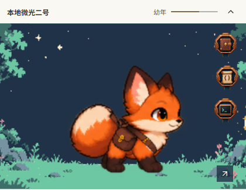

# 伙伴系统交付与验收

伙伴功能共用桌面与 Teams 前端、Go 领域逻辑及排名服务。当前正式角色资源为微光v8与其他六套v7，奖章为全色金属素材，背景随应用主题切换。整体设计见 [系统设计](companion-system-design.md)，持久化与公开边界见 [数据存储](companion-data-storage.md)。

## 已交付功能

| 功能 | 当前行为 |
| --- | --- |
| 入口与AI | 快捷命令旁的伙伴入口承接知识问答；大幅场景可收起，身份与经验合并展示，最多三枚奖章挂在背景右侧。ACP仍未接入 |
| 伙伴获取 | 首次免费开蛋，七种等概率；50点经验重开，排除当前物种。名字可改，保留ID、初次相遇时间、奖章与业务记录；Lv.1–Lv.100由剩余经验计算，形象及体型固定 |
| 人设 | 设置 → 伙伴与奖章，单行折叠入口；模板、编辑、恢复默认与独立保存。下一次问答生效，未保存关闭确认、4000字限制和版本冲突保护 |
| 成长 | 成功连接、完成传输和脚本完整派发由后台结算，经验有每日上限；点击动作不加经验 |
| 奖章 | 知识归档、脚本制作、指令制作、结案、知识查阅、脚本应用、指令应用、活跃日期八类；铜银金与下一目标 |
| 排名与资料 | 显式绑定与参与，同组织八个累计榜、并列名次和分页；公开伙伴、精选奖章与八项统计。首版只有排名与查看 |
| 同步与恢复 | 离线队列、删除重算、补偿恢复、版本与迟到确认保护；成员凭据保存在OS Keyring。关闭暂停采集并保留存档 |
| 动作 | 七种角色按各自身体结构生成；回应12fps，步行16姿态/1.333秒，原生步幅48–60px。收步后回正待机，环顾两侧各停留1.3秒，大动作每45–75秒才调度一次，舒展和走动较少出现 |

旧花园运行代码、货币、商店、库存、布局、植物包和专用工具已删除。已有 `garden.json` 保留，不读取或迁移为新功能启用授权。

## 架构与素材

个人成长由 `pkg/companion` 管理，`pkg/achievements` 管理本地事实与待同步状态，`pkg/companionsocial` 管理规则和排序；服务中心独立 `social.db` 管理认证成员与公开确认投影。公开数据不包含业务正文、命令、主机地址和本地路径。

七套正式角色包共664张256×256透明帧、35,541,557字节，所有等级共用母版与固定显示尺寸，大场景保持此前70%尺寸。绘制、步幅与活动范围使用同一比例。按当前动作加载，不一次下载整套角色库；换色缓存最多128项。微光原稿与提示词保存在 `art/companion/reviews/rabbit-v1`，其他角色见 [素材来源](../art/companion/roster-v5/README.md)，转换、内容契约与门禁见 [生产规范](companion-art-pipeline.md)。八类四等级奖章共32张128×128全色透明PNG、763,043字节。浅深背景两张WebP合计48,028字节。

## 开蛋与付费重开验收

首次开蛋免费，七种伙伴等概率出现；每次开蛋揭晓后均直接进入取名步骤，可保存1–24字的名字，首次也可保留默认名，重开可保留原名。保存失败保留输入，取名不额外扣经验。开蛋结果先独立落盘，关闭或中断取名不会丢失伙伴或再次抽取。后续重开消耗50点成长经验，排除当前物种，保留私有ID、初次相遇时间、业务去重和每日额度记录。等级根据剩余经验重新计算，奖章统计和自定义人设独立保留。已有存档升级时不自动重抽。自选物种与配色入口及旧绑定、RPC已移除；新开蛋使用原色，历史配色仍可读取。

开蛋动画在后端提交成功后开始，使用统一的2200毫秒时长：轻晃蓄力、加速摇动、停顿回弹、蛋壳分离，再以光晕、扩散环和八枚碎光揭晓伙伴并进入取名。新增效果仅使用有限次CSS位移与透明度动画，不增加逐帧脚本循环；静止入口不播放动画。减少动态效果偏好下跳过等待和装饰动效，直接展示结果。

开蛋由`pkg/companion.Store.Hatch(revision)`在OS文件锁内完成版本检查、余额校验、等概率抽取、扣费和原子保存；失败不发布结果，同版本重试不能重复扣费。没有新增货币、背包或第二份等级计数。桌面与Teams共享相同开蛋、确认、揭晓和改名界面，减少动态效果时跳过揭晓等待。插件API revision为2，要求`companion.hatch.v1`能力，防止新旧插件与后端混用；共享配置及伙伴存档结构保持版本1。

2026-10-15实页验证免费开蛋、取消付费确认、73→23点扣费与Lv.8→Lv.3、必定替换当前物种、余额不足和陈旧请求拒绝，以及重启持久化。付费用例仅在隔离测试存档中预置经验；34115现有伙伴保持原12点经验、Lv.2和修订号59，存档SHA-256逐字一致。领域测试覆盖双宿主并发只扣一次、随机数失败和写入失败不改存档。见[开蛋实测](assets/companion-hatch-v1/result.json)。

全量Go测试、共享前端312项、桌面前端265项、Teams单元35项和真实进程集成13项测试通过；桌面、共享前端与Teams类型检查及构建通过。完整浏览器回归11组通过，覆盖业务采集、奖章、两个独立桌面的排名与资料、离线退出与重启、关闭保留和明暗主题，见[业务回归](assets/companion-hatch-v1/social-result.json)与[视觉及交互记录](assets/companion-hatch-v1/social-visual-result.json)。已停用的自选形象验收脚本已删除；素材结构门禁及动画测试继续保留。

## 伙伴展示与开蛋仪式

设置页使用单独的伙伴取景区域，放大角色并保留脚部和较宽的身体部位；取景随窗口收缩，所有等级保持同样比例，侧边栏和助手场景尺寸不受影响。重新开蛋仅保留操作行末端的小型蛋形图标；费用、替换说明和经验差额通过悬停提示展示，点击后进入“另一次相遇”仪式。经验不足仍可查看仪式与费用，最终扣费动作禁用。

开蛋使用独立模态窗口，包含费用确认、开启过程和新伙伴揭晓；新结果保留至用户返回。窗口隔离背景操作和设置快捷键，支持键盘焦点循环、取消与Escape返回；减少动态效果时跳过等待。后台仍按原有50点规则原子扣费，没有修改接口或持久化结构。

真实程序验证见[仪式与展示记录](assets/companion-ritual-v2/result.json)。794px窗口无水平溢出，伙伴概览高度保持紧凑，见[窄窗口记录](assets/companion-ritual-v2/layout-794.json)。付费测试使用隔离存档，34115现有伙伴与经验保留。

## 1–100级成长验收

2026-10-14，成长改为纯数值等级：从Lv.1开始，每10点累计经验升一级，最高Lv.100，990点满级。等级不关联年龄阶段或形象缩放；助手、设置、公开资料统一显示等级，升级条展示本级经验，满级显示完整进度。所有等级保留相同的已验收体型。

等级及本级进度由Go从现有累计经验派生，不重复存储；旧公开阶段卡片可在同一伙伴修订号上一次性转换为等级卡片，精选奖章和正常版本排序保护保留。公开卡片仍不含原始经验、私有ID或事件记录。

全量Go测试、共享前端308项及桌面前端265项测试通过；桌面、共享前端、Teams类型检查与构建通过，Wails绑定已重新生成。等级边界、99升100、满级进度、旧资料兼容与升级、同版本及迟到更新保护有专项测试。34115实际页显示原12点经验对应Lv.2、进度2/10，认证同步后的公开资料也为Lv.2，伙伴数据与修订号保持一致；见 [实页记录](assets/companion-levels-v1/result.json)。本地桌面与排名服务已使用新构建，未发布Release或部署真实组织。

## 微光v8接入验收

2026-10-13，微光动作替换为坐卧、低伏跳步和贴地舒展，取消直立与抬手动作。共享伙伴测试49项、素材及工具测试25项通过；桌面、共享前端和Teams类型检查与构建通过。实际34115页面验证主题切换、70%绘制比例、左右走动、落地后点击回应、回正待机、舒展、收起停止切帧、减少动态效果和794px窗口，伙伴存档保持一致，无页面异常。证据见 [实页记录](assets/companion-rabbit-v8/result.json)。

当前本地与普通构建均使用45–75秒的安静调度，快速预览开关已从产品代码移除。上述首次v8实页记录使用过3秒预览频率；后续专项只在独立测试页面缩短环境等待，不改变产品构建、逐帧速度或真实位移。自然待机与架构检查见 [代码质量审视](companion-code-quality-review.md)。源稿与输出已检查低伏姿态和肢体替换；格式与程序行为通过不等于所有动画细节已获得视觉认可。

动作播放器以片段序列与一个共享时间起点协调图片和浏览器位移。行走按完整步幅结算，在落地接触帧完成后停步；停下保持位置，转回正面待机。行走中点击在下一脚接触时选择对应收步片段，再转入和回应，隐藏、离屏、收起及减少动态效果取消调度与移动。尺寸变化冻结并限制边界。静态侧站不持续更新姿态，播放循环不执行Canvas换色。

## v7历史动作验收

| 检查 | 结果与证据 |
| --- | --- |
| 共享伙伴测试 | 伙伴相关47项通过；覆盖共享时间、静态代表帧、接地打断、末帧完成竞态、长待机、稀疏环境动作、行走回正与实际420px幼年场景的步幅 |
| 类型与构建 | 桌面、共享前端、Teams类型与构建通过，三端执行正式资源门禁。本轮没有改动Go业务逻辑 |
| 素材门禁与工具 | 25项通过；覆盖PNG/Alpha、配准、源稿分格、脚底、1333ms周期、步幅、两侧停留、公共端点、脚接触和静态代表帧 |
| 正式素材复核 | 七角色28组新动作与21组保留动作检查，修正与候选拒收记录见 [v7报告](companion-anatomy-review.md) |
| 实际34115页面 | 44秒自然待机与七种未保存外观招呼预览通过；当前星角存档的左右走动、回正、接地中断、减少动态效果、窄窗口、收起与草稿保留通过，存档不变。走动专项仅加速环境等待，帧与位移保持正式速度，详见v7报告 |
| 正式素材记录 | 七包686文件与重建staging一致，49组源稿与正式文件SHA见 [素材记录](assets/companion-v7-asset-verification.json) |
| 性能 | v7本机行走脚本8.99ms/秒、0次布局；收起3秒0帧变化；输入P95 11.02ms。形象选择仍有一次61ms长任务。详见 [性能记录](companion-performance.md)，不将单轮数字当成所有设备的保证 |

本轮只调整角色资源与前端动作。业务Go逻辑的全量测试、两成员身份隔离、离线退出、重启恢复、真实传输及Teams真实进程集成，已在此前整体验收中通过；该历史结果不表述为本轮重新执行。复现整体业务流程见 [本地实测](../e2e/SOCIAL-LOCAL.md)。

v6的567项全量前端测试与重建记录为历史结果；旧视觉复审遗漏了多余肢体，已在原报告标记，不能作为v7的身体结构证明。

## 运行与边界

```powershell
./e2e/harness/social-resume.ps1
node e2e/harness/companion-ambient-review.mjs e2e/.runtime/companion-ambient-review
node e2e/harness/companion-performance-review.mjs e2e/.runtime/companion-performance
```

本地测试实例运行于 `http://127.0.0.1:34115/`，恢复脚本保留数据。旧标签不自动刷新，以保留未保存的对话和输入；新页面使用最新构建。

当前完成本地代码、正式素材、构建与运行验收，未发布Release、未部署到真实组织，也未验证外部Teams宿主的人工试用。AI问答实页使用隔离端点检查真实调用与错误响应，不作为真实模型质量评估；本轮没有调整对话历史或AI能力。成长仅显示1–100级，不使用幼年、成长、成熟及阶段体型。AI生成帧可能存在细微纹理变化，公共端点和格式检查不能替代逐动作视觉复审。


