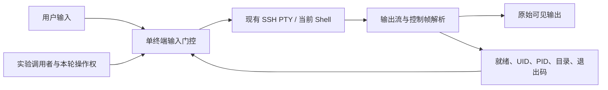

# 普通终端接手：阶段 1 技术探索

状态：2026-10-20，本机隔离原型及有限验证完成；生产集成、内网验证和产品验收未完成。

后续进展：控制器已提取到 `pkg/terminalcontrol`，桌面接入固定场景的[终端接手测试](terminal-handoff-trial.md)。下文记录阶段 1 的原始验证范围；该测试入口不代表完整阶段 2 或 Chrys 集成已完成。

## 1. 结论与决策

**在已确认空闲、能够提供临时提示符标记的普通 Shell 中，可以沿用现有 SSH PTY 接手操作，并保留当前账号、目录和环境。** 本次在 BusyBox ash 1.36.1 与 Bash 5.2.37 上验证了这条路径，可以据此继续设计正式终端适配器和统一操作控制。

这不代表可以无条件接管任意终端。首次连接尚未建立状态观测、`su -` 重置环境、提示符扩展关闭或前台程序状态未知时，需要与用户确认，不能自动发送探测代码。此限制符合首版“普通命令行优先，未知状态先沟通”的产品边界。

阶段 1 的本地技术探索已经给出可行性证据。全局阶段 0 的能力盘点、真实目标 Shell 验证和正式控制链路仍需继续，不因此宣布 M0 或统一架构已经完成。

## 2. 当前代码为什么不能直接做到

现有 `pkg/sshclient/client.go` 的 `StartShell` 提供真实 PTY 的输入输出，具备沿用终端的基础。但 `RunWithContext` 使用新 SSH session，不能继承人工已进入的目录、临时环境或 `su` 后身份。

`app.go` 的 `Write`、`SendCommand` 直接写终端输入；`pkg/terminal/command_extractor.go` 负责提取人工命令，不是 Shell 状态和命令完成协议。仅在前端增加遮罩，仍不足以控制后台、快捷命令等输入来源，也不能得到可靠完成状态。

因此，需要在现有 PTY 上增加输入门控与状态观测，并在应用层统一检查操作权。终端字节流继续直达页面，不通过通用业务 RPC 逐字符转发。

## 3. 原型方式

确认普通 Shell 后，在当前进程的 PS1 前加一个可移除的自包含前缀。每次 Shell 真正返回提示符时，前缀输出带随机标识的控制帧，包括退出码、有效 UID、Shell PID 和十六进制编码的目录；解析器从可见字节流中移除有效控制帧。用户命令仍原样送入当前 Shell，目录和环境变化不会丢失。

原型每次只允许一条 AI 命令等待完成。操作权绑定终端实例及代次；撤销后，等待发送的旧调用必须重新检查并失败。人工输入与 AI 操作互斥；人工存在未提交输入时，迟到提示符也不能使终端恢复为可接手。

前缀不依赖跨账号继承 Shell 函数，因此实验中的普通 `su` 可继续上报新身份。登录式 `su -` 会清除环境，原型保持未知状态，待明确确认新命令行后在同一会话重新建立观测。不会替用户重新 SSH 登录或伪装成继承了旧现场。

## 4. 验证证据

测试使用 Windows 上的临时回环 SSH 服务，复用生产 `sshclient.NewClient` 和 `StartShell`，通过一次 SSH Shell channel 连接 WSL 中的真实 Linux PTY。不是只回显字符串的假终端，也未连接业务服务器。

| 场景 | ash 1.36.1 | Bash 5.2.37 | 观察事实 |
|---|---|---|---|
| 人工进入目录、设置环境后交给 AI | 通过 | 通过 | 同一 PID、目录和环境值保留 |
| AI 修改目录、环境后人工接回 | 通过 | 通过 | 人工命令读到 AI 修改后的状态 |
| 命令失败 | 通过 | 通过 | `false` 得到退出码 1，不靠提示符文本猜测 |
| 占用期间人工输入 | 拒绝 | 拒绝 | 输入门控未写入人工命令 |
| 前台 reader 占用终端 | 拒绝接手 | 拒绝接手 | 未确认时不发送 bootstrap |
| 运行中停止与旧命令失效 | 通过 | 通过 | 撤销后下一条旧调用未写入；独立 Ctrl-C 后收到退出码 130 |
| 普通 su 切到 UID 65534 | 通过 | 通过 | 子 Shell 的真实 UID/PID 可观察；退出后恢复原父 Shell |
| su - 重置环境 | 按未知处理 | 按未知处理 | 拒绝直接接手；明确确认后在当前登录 Shell 重新接入 |
| 原提示符恢复 | 通过 | 通过 | 移除自身精确前缀后仍为原实验提示符 |
| 未使用新 exec 会话 | 通过 | 通过 | 每个 Shell 子测试只接受 1 个 session，exec 请求数为 0 |
| 已有 PROMPT_COMMAND | 不适用 | 有限通过 | 实验中的 `PROMPT_COMMAND='true'` 未破坏失败退出码 |
| 关闭 promptvars | 不适用 | 按不支持处理 | bootstrap 超时，不授予操作权；实验显式恢复配置后清理 |

Bash 的普通 su 子 Shell 也是 Bash；为适配实验目录中的动态库，由实验命令显式设置库路径。登录式 su 子 Shell 使用 `/bin/sh`。这不是所有 su/sudo 和 Shell 组合的兼容性证明。

另外有 **12 项确定性单元测试**，覆盖控制帧碎片/非法值、未知终端、已取消 bootstrap、未提交人工输入、完成判断、断连、超时、操作权撤销、跨终端误用、非法命令、传输阻塞与部分写入。

最终验证记录：

- `run-lab.ps1 -PrepareBash -Count 3`：12 项单元测试及两种真实 PTY 子测试，连续 3 轮通过。
- `go vet ./experiments/terminalhandoff`：通过。
- `go test ./pkg/terminal -count=1`：通过，作为邻近已有模块回归。
- `go test -race`：未执行成功；本机缺少可用 C 编译器，CGO 关闭。不声称完成竞态检测。
- 未运行整个历史 SSH 测试集；本次验证仅涉及显式列出的包与本机实验服务。

日志：[本机实验验证](../e2e/.runtime/terminal-handoff/validation-repeat.log)。日志和下载依赖属于忽略的运行产物，其他检出需要按 [实验说明](../experiments/terminalhandoff/README.md) 重新生成。依赖版本与固定哈希随源码保存在清单中。

## 5. 必须保留的限制

**输入权撤销与远端结束是两个事实。** 停止时可立即使旧操作权失效，但已经提交给传输层的字节无法撤回。正在阻塞的写入也可能晚于撤销才返回。Ctrl-C 是否生效要等待实际现场；终端未返回时呈现“AI 已停止，远端命令状态待确认”，不能伪报取消成功，也不能自动重试。

**临时提示符集成不是零影响。** 它会临时改变 PS1，并在每次提示符展开时运行 id、od、tr。自定义提示符覆盖、禁用展开、严格 Shell、历史记录和特殊启动脚本需要分别适配。仅验证了实验提示符恢复；没有验证任意用户复杂提示符的行为或性能。状态未知时不能盲目发送安装、恢复或清理命令。

**提示符返回不等于所有子进程完成。** 后台作业可以继续输出，重绘和异步通知可能混入命令输出。原型保留可见字节并观测前台返回，但未实现通用、严格的每条命令输出归属与请求级完成关联。正式适配器需明确关联规则、排除后台任务，并验证迟到/重复标记，不能直接把当前解析器作为通用执行契约。

**未知状态优先保护现场。** 完整 readline 编辑、粘贴、多行输入、vim/less/zsql 等交互式程序不在首版自动输入范围。单行长度限制也不是安全判定，不能阻止单行内包含修改或多个命令。

**原型不是权限系统。** 随机标识用于控制帧关联，远端可以看到它，不是防恶意输出伪造的安全边界。Controller 只管单终端占用，尚未绑定全进程 AI 轮次、真实身份、审批和实际命令审计；多个原型 Controller 也没有实现全局单 AI 调度。没有接前端遮罩、队列、Chrys 或 MCP。

**本地通过不是内网兼容结论。** 未验证内网 Shell 版本、su/sudo 策略、跳板链、SSH 断网背压、所有终端控制序列或吞吐表现。实验桥仅用于测试，不作为部署到内网节点的依赖。

## 6. 下一步及后续推进条件

下一步进入阶段 2 的正式终端纵向实现，同时补齐阶段 0 的终端入口与状态清单：

1. 定义 Shell 能力、就绪/未知状态、命令提交/完成/结果未知等契约，解决输出归属及请求关联；将本次兼容限制转化为产品支持范围。
2. 建立全进程 AI 轮次与页签占用服务，将输入权绑定具体轮次、页签和底层终端。所有人工/快捷命令/AI 输入入口经过同一门控，实际提交前核验权限和代次。
3. 增加真实授权与审计，先使用可控测试调用者完成接手、停止、提问释放及人工接回；再接遮罩、页签标题和上下文呈现，保留原有人工体验。
4. 在代表性内网普通命令行复测 PS1、账号切换和跳板环境；不适配的场景明确提问，避免静默换新会话。

这些门槛通过后，再进入阶段 3 的 Chrys 排障闭环。数据库、轻量动作和逐域迁移仍按 [全局路线](application-kernel-architecture.md#10-整体实施路线与阶段交付) 推进，不以这个原型替代后续阶段。
